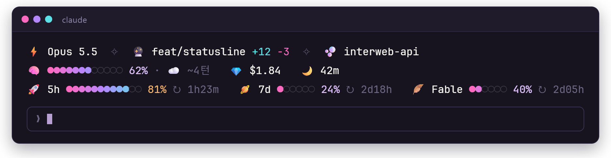
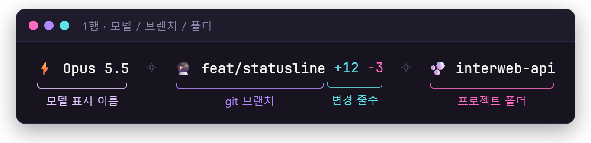
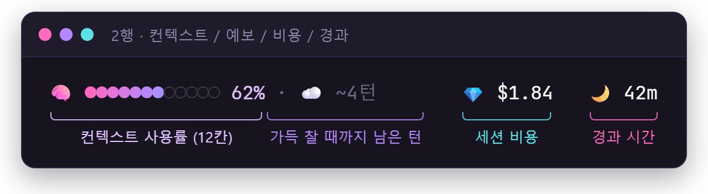
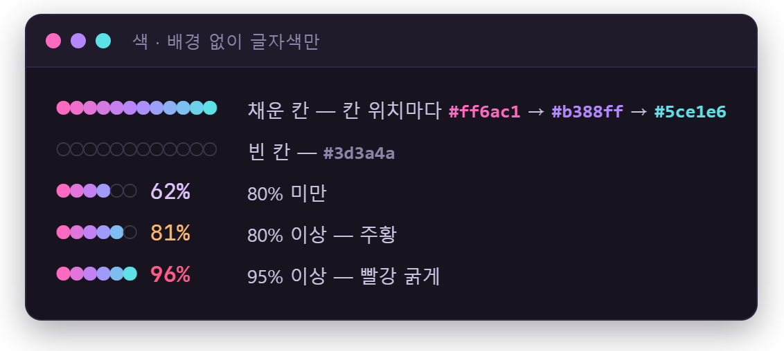
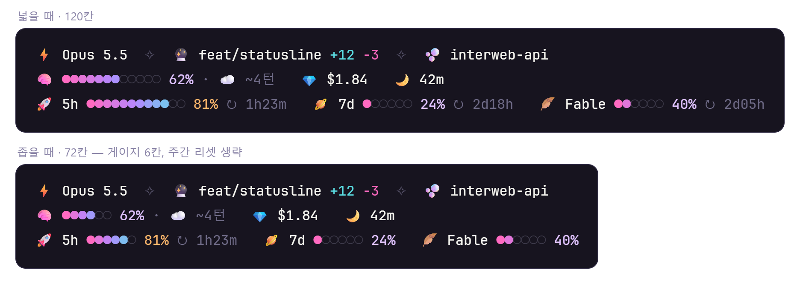

# neon-bubble

Claude Code **Mods**(function hooks 플러그인)입니다(v0.2). 프롬프트 위 네온 버블 상태 띠, 스피너 꼬리·턴 요약 줄·컨텍스트 남은 턴 추정, 사용량 알림, 사이드 패널, 차단/묻는 가드, flow 단위 자동 compact, 편집 리플레이(`/replay`), 서브에이전트 모델 분배(`/model-route`), 네온 도구 행을 더합니다. Windows Terminal / VS Code 터미널(PowerShell)과 JetBrains Mono(Nerd Font 아님) 기준으로 만들었으며, Nerd Font 전용 글리프는 쓰지 않습니다.



## 설치

GitHub 저장소(마켓플레이스 `dune-kit`)에서 설치합니다. 터미널 세션의 프롬프트에 입력하세요.

```
/plugin marketplace add mhjoon99/dune-kit
/plugin install neon-bubble@dune-kit
```

`Add marketplace?` 에 `y`, 범위는 user(기본)를 Enter 로 고르고, 설정 화면에서 userConfig 값을 정하면 바로 켜집니다.

로컬 폴더에서 쓰려면 이 저장소 루트를 마켓플레이스로 추가한 뒤 설치합니다. 폴더 마켓플레이스는 복사본이 아니라 폴더 자체를 읽으므로, 고친 뒤 `/reload-plugins` 만 하면 됩니다.

```
claude plugin marketplace add <이 저장소 폴더>
claude plugin install neon-bubble@dune-kit
```

개발 중에는 `claude --plugin-dir <저장소>/plugins/neon-bubble` 로 그 세션에만 불러올 수 있습니다(저장하면 핫리로드).

## 기능

### 1. 상태 띠 (프롬프트 위 3줄)





남은 턴은 10턴까지는 `~7턴`처럼 그대로, 그 위로는 10턴 단위로 내림해 `40+턴`처럼, 100턴 이상은 `100+턴`으로 표시하고, 추정할 수 없으면 생략합니다. 비용을 모르면 비용 칸도 생략합니다.


리셋까지 남은 시간은 **`resetsAt - 지금`** 으로만 계산합니다(분 단위 내림, 하루 이상이면 시간까지 `2d05h`). Fable 은 창 이름에 `fable` 이 들어간 창이 들어올 때만 그리고, 구독이 아니어서 값이 없으면 3행 전체를 생략합니다.





폭이 좁으면 게이지를 최소 6칸까지 줄이고, 그래도 넘치는 행에서만 1행은 폴더명, 2행은 비용 → 경과 시간, 3행은 7d·Fable 의 리셋 시간을 뺍니다.

| 항목 | 동작 |
| --- | --- |
| 브랜치 | `git` 프로세스 없이 `.git/HEAD` 를 직접 읽음(detached 면 짧은 SHA, worktree 의 `gitdir:` 도 처리) |
| 변경 줄수 | `git diff --shortstat HEAD` |
| 갱신 | 세션 시작, Bash/PowerShell/Edit/Write/MultiEdit 실행 뒤, 5초마다(브랜치는 2초) |
| 실패·빈 값 | 실패하면 마지막 값을 그대로 그림. "loading..." 없이 값이 없는 칸만 빠짐 |

이미지는 `node assets/render.mjs` 로 `hooks/format.ts` 의 실제 색·배치를 써서 다시 만들 수 있습니다(Windows Edge 필요).

### 2. 사용량 알림 (토스트)
5시간·7일·Fable 주간·컨텍스트가 `warnPercent`(80)를 처음 넘으면 주의, `alertPercent`(95)를 넘으면 경고 토스트를 한 번 띄웁니다. 같은 창·같은 단계는 리셋(`resetsAt` 변경) 전까지 다시 띄우지 않고, 컨텍스트는 compact 로 주의선 아래로 내려갔다가 다시 넘으면 다시 알립니다.

### 3. 사이드 패널 — `/side-panel`
`/side-panel` 로 열고 닫습니다. `autoOpenPanel` 이 켜져 있으면 세션 시작 때 열기를 요청하며, 엔진은 터미널이 144칸 이상일 때만 자리를 줍니다(좁으면 대기했다가 넓히면 나타남).

| 섹션 | 내용 |
| --- | --- |
| ✏️ 수정한 파일 | 이번 세션 Edit/Write/MultiEdit/NotebookEdit 대상(저장소 상대 경로)과 횟수, 최근 순 12개. 경로는 링크라 Ctrl+클릭하면 파일이 열림(`editLinkScheme`) |
| 🛠 도구 호출 | 시각·도구·요약(Bash 는 명령 앞 40자, 파일 도구는 파일명), 실패는 빨강, 최근 15개 |
| 📈 사용량 추이 | 컨텍스트 %·5h % 스파크라인 `▁▂▃▄▅▆▇█`, 최근 30개 측정 |
| 💾 메모리 변경 | 이번 세션에 바뀐 메모리 파일과 시각 |
| 📝 메모 | 한 줄 메모 입력, 항목별 `✓`(완료)·`✕`(삭제). 저장소 루트별로 영속 저장. 모바일은 입력칸 없이 목록만 |

패널 높이가 모자라면 섹션별 개수를 줄입니다.

### 4. flow 단위 자동 compact
앞 요청과 이어지는 작업 묶음을 flow 로 보고, 별개의 새 작업이 시작되면 직전 flow 를 compact 합니다.
- `/` 명령, 첫 프롬프트, 컨텍스트가 `compactMinPercent`(30%) 미만이면 그대로 통과.
- 20자 미만의 짧은 맞장구("응 진행해", "좋아", "ㅇㅇ")는 분류 없이 이어지는 작업으로 봅니다.
- 그 외에는 최근 프롬프트 3개(각 300자) + 새 프롬프트를 `$.model.classify` 로 `continue`/`new` 판정.
- `new` 이면 프롬프트를 잠시 보류(drop)하고, 턴 밖에서 `방금 끝난 작업 흐름의 결과·결정·남은 일만 짧게 남긴다` 지시로 compact 한 뒤 같은 텍스트를 다시 보냅니다. 토스트: `🧹 새 작업 흐름 — 이전 흐름을 정리했어요`.
- 어느 단계든 실패하면 원래 프롬프트를 그대로 보냅니다(compact 실패 시에도 재전송, 재전송 실패 시 입력칸에 되돌림).
- `autoCompact` 를 끄면 동작하지 않습니다.

### 5. 메모리 변경 알림
Write/Edit/MultiEdit 대상이 메모리 폴더(`/.claude/memory/`, `~/.claude/projects/*/memory/`, 역슬래시 경로 포함)면 끝난 뒤 `💾 메모리 · <파일명> <생성|수정>` 토스트를 띄우고 패널에 기록합니다.

### 6. 가드
Bash·PowerShell 명령을 줄바꿈 `;` `&&` `||` `|` `&` 로 나누고, 각 조각에서 `VAR=val`, `sudo`, `command`, `env`, `nohup`, `time`, `exec`, `xargs` 등을 벗겨 실제 프로그램을 찾습니다. `bash -c "…"`, `pwsh -Command "…"`, `cmd /c …`, `$(…)` 안쪽도 펼치고, git 은 `-C <path>`, `-c k=v`, `--git-dir=` 같은 전역 옵션을 건너뛰어 서브커맨드를 찾습니다(`cd x && git commit` 의 위치도 반영). 그래서 `git -C x commit`, `sudo git push -f`, `FOO=1 git commit --no-verify` 도 잡힙니다.

**무조건 차단** (모델에게 이유 + 푸는 법을 돌려줌, `/guard-allow` 로만 1회 해제)

| 규칙 | 대상 |
| --- | --- |
| `env` | `git add` 대상에 `.env`/`.env.*` (`.env.example`·`.sample`·`.template` 허용). `git add -A/./--all` 인데 추적 안 된 `.env` 가 있으면 경고만 |
| `no-verify` | commit/push/merge 의 `--no-verify`, commit 의 `-n`, `git -c core.hooksPath=…` |
| `protected-branch` | 현재 브랜치(-C·cd 반영)가 `protectedBranches` 인데 `git commit` |
| `private-ip` | Edit/Write/MultiEdit/NotebookEdit 가 새로 넣는 내용에 10/8·172.16/12·192.168/16 주소가 있고, 파일이 git 추적(또는 ignore 안 된 새 파일)이며 `ipExemptPaths` 밖일 때. 127.x 와 RFC 5737 문서용 주소는 허용 |

**묻기** (명령을 잡아 두고 `$.ui.ask` 로 `실행`/`거부`)

강제 push(`--force`, `-f`, `+refspec`; `--force-with-lease` 는 허용)와 파괴적 명령(`rm -rf` 의 대상이 `/`·`~`·`$HOME`·`*`·`.`·`..`·드라이브 루트·저장소 루트, `git reset --hard`, `git clean -f…`, `git checkout -- .`, `git restore .`, `Remove-Item -Recurse -Force`, `rd /s`, `rmdir /s`, `del /s`, `format`, `mkfs`, psql/mysql 안의 `DROP DATABASE/TABLE`)은 묻기 전에 읽기 전용 명령(5초 제한)으로 **무엇이 바뀌는지** 미리보기를 만듭니다. 실패하면 미리보기 없이 이유만 보여 줍니다.

| 명령 | 미리보기 |
| --- | --- |
| `rm -rf <경로>` 등 | 대상의 파일 수·전체 크기·상위 경로(항목 2000·폴더 200 상한) |
| `git reset --hard` | `git status --short` 의 날아갈 변경 파일 + `git stash list` 개수 |
| `git clean -f…` | `git clean -n`(dry-run) 결과 |
| `git checkout -- .` / `git restore .` | `git diff --stat` |
| 강제 push | 덮어써질 원격 커밋 `git log --oneline HEAD..<remote>/<branch>`(원격 ref 없으면 생략) |

```
⚠️ 되돌릴 수 없는 명령이에요 — git reset --hard
날아갈 변경: 3개 파일 (src/a.py, src/b.py, src/c.py)
실행할까요?
```

`실행` 이 아니면(거부·닫기·직접 입력·`claude -p` 에서의 reject) `사용자가 이 명령을 거절했어요. 다른 방법을 쓰기 전에 먼저 물어보세요.` 로 막습니다.

**경고(토스트만)**: 보호 브랜치로의 일반 push, `chmod 777`, `curl|wget … | sh/bash`, `npm publish`, `docker system prune`, `kubectl delete`, `git branch -D`, `git stash drop/clear`.

**주석 과잉 경고**: Edit/Write/MultiEdit 의 새 내용에서 파일 머리 주석과 함수/클래스 doc 주석을 빼고, 연속 주석(`#`, `//`, `--`, `;`, `/* */` 내부, YAML `#`)이 `commentMaxLines`(3)를 넘으면 `💬 주석 N줄 — 주석은 '무엇을'과 '왜'만 1~2줄로 (comments 규칙)`. 막지는 않고 같은 파일·같은 턴에 한 번만.

### `/guard-allow <규칙>`
무조건 차단 4종(`env`, `no-verify`, `protected-branch`, `private-ip`) 중 하나를 **다음 1회만** 통과시킵니다. 모델은 슬래시 명령을 칠 수 없고, 다른 플러그인이 `$.command.run` 으로 부른 경우도 거절하므로 사람의 승인으로 간주됩니다. 묻기 규칙은 매번 직접 답하므로 대상이 아닙니다.

### 7. 스피너 꼬리 · 턴 요약 줄
- 턴 중 스피너 뒤에 ` · 🛠 3 · ⏱ 12s · 💎 $0.04…`(이번 턴 도구 호출 수, 경과, 턴 비용; 비용을 모르면 생략)를 붙입니다. 엔진 스피너는 그대로이며 1초마다 갱신, 턴이 끝나면 타이머를 멈춥니다.
- 메인 대화 턴이 끝나면(중단 제외) 답 아래에 `✓ 12s · 도구 5 · 입력 12.3k · 출력 1.2k · 캐시 81%`. 입력 = input + cache_read + cache_creation, 캐시율 = cache_read / 입력.

### 8. 컨텍스트 남은 턴
메인 대화의 요청마다(`turn.step`) usage 로 컨텍스트 크기를 재고, 턴 끝 크기의 최근 5번 증가량 평균으로 "가득 찰 때까지 남은 턴"을 추정합니다. 띠 2행과 사이드 패널 사용량 추이에 표시합니다.

### 9. `/replay [N]` — 편집 리플레이
턴마다 성공한 Edit/Write/MultiEdit/NotebookEdit 을 기록(턴당 50개, 항목당 20KB, 최근 10턴)하고, `/replay` 로 직전 턴(`/replay 2` 는 두 턴 전)의 편집을 창에서 한 단계씩 봅니다. `n` 다음 · `p` 이전 · Esc 닫기, diff 는 `Code format="diff"`. 헤더 `3/7 · src/app/main.py · Edit`. 편집이 없으면 토스트.

### 10. `/model-route` — 서브에이전트 모델 분배
에이전트 type 별 `{ agentType, model, effort? }` 규칙 표(기본은 비어 있음, `$.store` 영속). 서브에이전트 요청(`turn.step` 의 `agentId` 가 있을 때)만 `$.agent.list()` 로 type 을 찾아 규칙대로 model·effort 를 바꾸고, 메인 대화는 절대 바꾸지 않습니다. 바뀔 때 턴·에이전트별 첫 1회만 흐린 줄 `model-route: code-explorer → sonnet` 을 남깁니다. 창에서 규칙 목록(삭제), 추가 폼(에이전트 type·모델·effort `Select` + 직접 입력), 이번 세션에서 바뀐 요청 수를 봅니다.

### 11. 네온 도구 행 · 프롬프트 힌트
- 도구 호출 행(ToolUse, 접힌 ToolGroup)은 엔진 행을 그대로 두고 앞에 아이콘·색만 붙입니다: Bash 🐚, Edit/MultiEdit ✏️, Write 📝, Read 📖, Grep/Glob 🔍, Agent/Task 🤖, WebFetch/WebSearch 🌐, mcp__* 🔌. 실패 행은 `#ff5c8a`. `neonToolRows` 로 끕니다.
- 프롬프트 힌트 줄 끝에 흐리게 `/side-panel · /replay · /model-route` (입력 중·작업 중엔 생략, 터미널만 그림).

### 명령
`/side-panel`, `/replay`, `/guard-allow`, `/model-route` 는 모두 `immediate` 로 등록되어 턴 중에도 바로 실행됩니다.

## 설정 (userConfig)

| 키 | 형식 | 기본값 | 설명 |
| --- | --- | --- | --- |
| `protectedBranches` | string | `main,master,stage` | 직접 커밋 차단·push 경고 브랜치 |
| `ipExemptPaths` | string | `docs/,.claude/,.env,.env.local` | 사설 IP 허용 경로(`/` 로 끝나면 폴더, 아니면 파일명/경로) |
| `commentMaxLines` | number | `3` | 연속 주석 허용 줄수 |
| `autoCompact` | boolean | `true` | flow 단위 자동 compact |
| `compactMinPercent` | number | `30` | 이 컨텍스트 % 미만이면 flow 판정 안 함 |
| `warnPercent` | number | `80` | 주의 알림 기준 |
| `alertPercent` | number | `95` | 경고 알림 기준 |
| `autoOpenPanel` | boolean | `true` | 세션 시작 시 사이드 패널 열기 요청 |
| `neonToolRows` | boolean | `true` | 도구 호출 행 아이콘·색 |
| `editLinkScheme` | string | `file` | 패널 "수정한 파일" 링크 방식. `file` 은 `file://`(터미널이 엶), `vscode`·`cursor` 등은 `<scheme>://file/…` 로 그 에디터 새 탭 |

`/config` 메뉴에서 바꾸면 모듈이 새 값으로 다시 로드됩니다.

## 구성

```
plugins/neon-bubble/
  .claude-plugin/plugin.json
  hooks/hooks.json        # { "modules": ["./register.tsx"] }
  hooks/register.tsx      # 모든 훅·그리기·git 읽기·미리보기 수집($ 를 쓰는 코드는 이 파일에만)
  hooks/guard-rules.ts    # 명령 파싱·차단/묻기/경고 판정·사설 IP·주석 카운터(순수 함수)
  hooks/format.ts         # 색·게이지·시간·띠 배치·알림·턴 요약·남은 턴·diff·미리보기 문구(순수 함수)
  hooks/flow.ts           # flow 단축 규칙과 분류 입력(순수 함수)
  hooks/route.ts          # 모델 분배 규칙(순수 함수)
  types/index.d.ts        # $.state 계약(PluginState['neon-bubble'])
  tests/*.test.ts(x)      # claude plugin test
```

검증:

```
claude plugin validate plugins/neon-bubble
claude plugin test plugins/neon-bubble
```

## 알려진 제약

- **flow compact 순서**: 엔진은 `prompt.submit` 훅 안에서의 `$.session.compact` 를 거부합니다(그 프롬프트의 턴을 붙잡고 있기 때문). 그래서 "보류(drop) → 훅 밖 타이머에서 compact → `$.prompt.submit({ asUser: true })` 로 재전송" 순서로 동작합니다. 재전송된 프롬프트는 모델에게는 사람 말 그대로 읽히지만, 트랜스크립트 기록상 출처는 이 플러그인입니다. 화면에는 보류 사유 한 줄이 먼저 보입니다.
- 이미지 등 첨부가 있는 프롬프트는 재전송하면 첨부가 사라지므로 `new` 로 판정돼도 compact 하지 않고 그대로 보냅니다. 턴 실행 중에 입력해 끼어든 프롬프트도 판정하지 않습니다.
- 보류와 재전송 사이(수 ms)에 플러그인이 핫리로드되면 타이머가 취소될 수 있습니다. 그 경우 프롬프트를 다시 입력해야 합니다.
- 가드의 명령 파싱은 단순 토크나이저 기반의 최선 노력입니다. `eval`, 변수에 담긴 명령(`$CMD`), alias/함수, 스크립트 파일 안의 내용, PowerShell `-EncodedCommand` 는 보지 못합니다. 브랜치 판단은 `-C`·`cd` 를 반영하지만 `--git-dir`/`--work-tree` 는 반영하지 않습니다.
- 사설 IP 규칙은 "git 에 올라갈 파일(추적 중이거나 ignore 되지 않은 새 파일) **이고** 예외 경로 밖"일 때 차단합니다. 저장소 밖 파일은 검사하지 않습니다. Edit 에서 이미 `old_string` 에 있던 주소는 새로 넣은 것으로 보지 않습니다.
- 이 빌드의 내장 도구 목록에는 `PowerShell`·`MultiEdit` 가 없습니다. 도구 이름으로 비교하므로 있는 빌드에서는 그대로 동작합니다.
- 주석 카운터: Edit 의 부분 수정은 파일 머리인지 알 수 없어 머리 주석 예외를 적용하지 않습니다. 함수/클래스 docstring 은 선언 바로 앞의 `/** */`·`///` 블록으로 판정하며, Python `"""docstring"""` 은 원래 주석으로 세지 않습니다.
- 경과 시간·리셋 남은 시간은 분이 바뀔 때만 다시 그립니다(5초 주기 확인). 7일 행에는 명세 예시대로 리셋 시간을 표시하지 않습니다(알림 토스트에는 표시).
- 칸 폭 계산은 이모지·한글을 2칸으로 보는 추정입니다. 터미널·글꼴에 따라 한두 칸 차이가 날 수 있습니다.
- 사이드 패널의 시각(HH:MM)은 플러그인 실행 환경의 시간대를 따릅니다.
- 사이드 패널 자동 열기는 엔진 규칙상 144칸 미만에서 대기 상태가 되며, 창을 넓히면 그때 나타납니다.
- **묻는 가드**: `$.ui.ask` 는 고른 라벨만 돌려주므로, 대화상자가 자리 비움으로 자동 응답된 경우를 구분하지 못합니다(`실행` 이 아니면 모두 거절 처리). 미리보기는 읽기 전용 명령 하나당 5초 제한이며, `rm` 미리보기는 항목 2000개·폴더 200개에서 멈추고 `+` 를 붙입니다. `del /s`, `format`/`mkfs`, `DROP` 은 미리보기 없이 이유만 보여 줍니다.
- v0.1 에서 무조건 차단이던 강제 push·파괴적 명령은 v0.2 에서 묻기로 바뀌었고, `/guard-allow force-push|destructive` 는 더 이상 받지 않습니다.
- 턴 요약 줄은 `turn.complete` 의 다른 `text` 로 답 아래에 그려집니다. 다른 플러그인이 같은 자리를 쓰면 위쪽 플러그인 것이 보입니다. 턴 비용은 턴 시작·진행 중 `$.session.usage()` 의 비용 차이라서 서브에이전트 비용도 포함됩니다.
- 스피너의 도구 수는 이번 턴의 모든 도구 호출(서브에이전트 포함, 가드의 묻기 대화상자 제외)입니다.
- 컨텍스트 남은 턴 추정은 메인 대화 요청 usage(input+cache+output)의 턴 끝 값만 쓰며, 자동 compact 임계값이 아니라 모델 창 크기 기준입니다. 두 턴 이상 증가가 쌓여야 표시됩니다.
- `/replay N` 은 엄밀히 N 턴 전(편집이 없는 턴도 한 턴으로 셉니다)입니다. Edit 의 diff 는 `old_string`/`new_string` 기준이라 줄 번호가 실제 파일 위치와 다르고(1부터), Write 는 쓰기 전 파일을 읽어 비교합니다. NotebookEdit 은 새 셀 내용만 보여 줍니다.
- 모델 분배: 에이전트 type 은 `$.agent.list()` 에 아직 없거나 이미 빠진 agentId 면 알 수 없어 바꾸지 않습니다. 모델 이름은 그대로 엔진에 넘기므로 세션에서 못 쓰는 모델이면 그 요청이 실패할 수 있습니다.
- 네온 도구 행은 엔진 행을 감싸는 방식이라 행 앞에 아이콘 한 칸이 생깁니다. 펼쳐진 ToolGroup 은 각 ToolUse 행이 대신 꾸며집니다. 프롬프트 힌트 꼬리는 현재 터미널만 그립니다.
