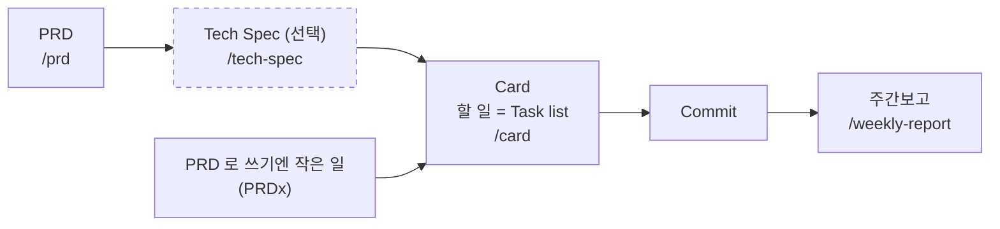
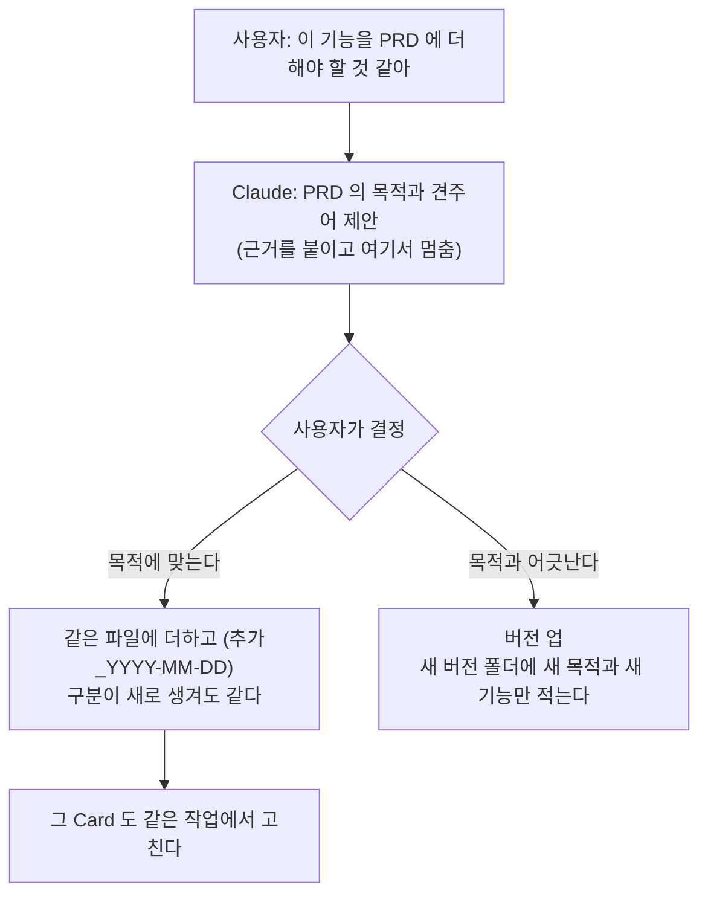
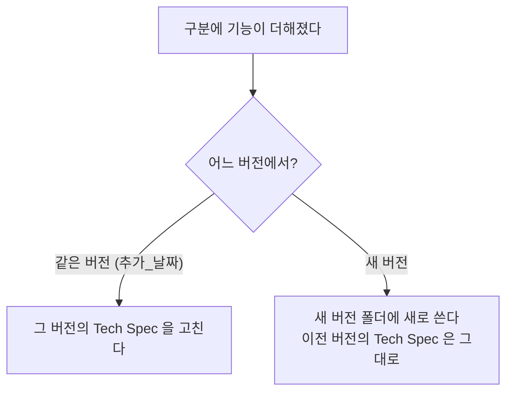
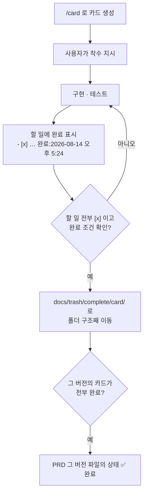

# work-kit

내장 `/init` 에 **업무 하네스**를 합치는 Claude Code 플러그인입니다(v0.1). `/init` 을 치면 내장 대화형 흐름(질문 → 분석 → 제안서 → 생성)이 그대로 돌고, 그 앞뒤에 묶음 선택과 work-kit 파일 생성이 끼어듭니다. 문서 명령 `/prd` `/tech-spec` `/card` `/daily-report` `/weekly-report` 도 함께 들어 있습니다.

## 설치

```
/plugin marketplace add mhjoon99/dune-kit
/plugin install work-kit@dune-kit
```

설치한 뒤 프로젝트 폴더에서 `/init` 을 칩니다.

`CLAUDE_CODE_NEW_INIT=1` 은 **필수가 아닙니다.** 켜면 내장 `/init` 이 질문을 주고받는 새 대화형 흐름으로 돌고, 꺼져 있으면 구버전 흐름으로 돕니다. work-kit 은 둘 다에서 같은 순서로 진행하지만, 켜 두는 쪽을 권합니다.

```powershell
# PowerShell — 이번 터미널에서만
$env:CLAUDE_CODE_NEW_INIT = "1"; claude
```

```bash
# bash·zsh — 이번 실행에서만
CLAUDE_CODE_NEW_INIT=1 claude
```

항상 켜 두려면 `~/.claude/settings.json` 에 넣습니다.

```json
{ "env": { "CLAUDE_CODE_NEW_INIT": "1" } }
```

## `/init` 순서

| 단계 | 하는 것 |
|---|---|
| ① 묶음 선택 | 6개 묶음 중 고른다(질문 두 개, 보통은 전부) |
| ② 프로젝트 기본 | 이름·빈 프로젝트 여부·스택 |
| ③ 분석 방향 | 내장 질문(CLAUDE.md 를 어떻게 할지 등). 빈 프로젝트면 건너뜀 |
| ④ 분석 | 내장 서브에이전트 탐색 + 테스트·린트 명령, 브랜치, 추적 중인 docs 파일 |
| ⑤ 채운 값 확인 | 제안서에 만들 파일과 채운 값(`이름 = 값`)을 보여 주고 확인받는다 |
| ⑥ 생성 | 확인받은 파일만 쓴다 |

다시 돌리면 기존 파일과 비교해 **차이만** 제안합니다. 사용자가 직접 고친 부분은 지우자고 하지 않습니다.
work-kit 없이 내장 흐름만 쓰려면 `/init --plain`.

## 묶음

| 묶음 | 프로젝트에 만드는 것 |
|---|---|
| 1. 업무 매뉴얼 | `rules/process.md` `prd.md` `tech-spec.md` `card.md` `docs-format.md`, `core.md` §1 |
| 2. Git·커밋·MR | `rules/gitlab-templates.md`, `.gitlab/merge_request_templates/Default.md`, `core.md` §3·§6 |
| 3. 이슈 | `rules/issues.md` `detected-issues.md`, `.gitlab/issue_templates/Bug.md` `Incident.md`, `core.md` §4 |
| 4. 보고 | `rules/weekly-report.md`, `core.md` §2 |
| 5. 저장소 정책 | `core.md` §5, `.gitignore` 의 `docs/*` |
| 6. 작업 태도 | `rules/work-attitude.md`, `.claude/settings.local.json` 의 `autoMemoryDirectory` → `.claude/memory/` |

배치는 **혼합**입니다. 명령·훅은 플러그인에 있고, 규칙은 프로젝트 `.claude/rules/` 로 복사돼 프로젝트마다 고칠 수 있습니다. 템플릿은 `templates/` 에 있습니다.
사내 도구 기본값은 docmost(문서)·Planka(카드)·GitLab(이슈·MR)·Jenkins(CI)이고 인터뷰에서 바꿀 수 있습니다.
가드는 neon-bubble 이 맡습니다. 메모리 변경 알림도 neon-bubble 이 합니다.

## 업무 흐름

묶음 1(업무 매뉴얼)이 깔아 주는 규칙의 흐름입니다. 사내 「업무프로세스」의 PRD → Tech Spec → Card → Commit → 주간보고를 로컬 원고 파일로 옮긴 것입니다.



로컬 파일은 사내 문서 도구·카드 도구에 붙여 넣을 **원고**입니다. Claude 가 직접 올리지 않습니다.

### 폴더 구조

```
docs/
  prd/
    00-회원-관리_v0.3/                ← PRD 버전마다 폴더 하나
      00-prd_회원-관리_v0.3.md
      tech-spec/                      ← 이 버전의 Tech Spec (구분 하나에 하나, 선택)
        01_로그인.md
        02_결제.md
    00-회원-관리_v0.4/
      00-prd_회원-관리_v0.4.md
      tech-spec/
        03_알림.md
  card/
    00-회원-관리_v0/                  ← PRD 버전 앞자리 단위 (v0.3·v0.4 가 같은 폴더)
      01_로그인/                      ← PRD "필요한 기능" 표의 구분
        01_소셜-로그인.md             ← 기능 하나 = 카드 하나
        02_자동-로그인.md
      02_결제/
        03_정기-결제.md
      03_알림/                        ← 나중에 생긴 구분은 다음 번호로 맨 아래
        04_가입-환영-메일.md
    PRDx/                             ← PRD 없는 카드
      01_첨부-입력-비용-절감.md
  trash/complete/card/                ← 완료된 카드. card/ 아래 경로 그대로 옮긴다
  reports/daily/ · reports/weekly/
```

구분 번호는 Card 의 구분 폴더와 Tech Spec 파일명이 같습니다(`02_결제/` ↔ `02_결제.md`).

### PRD — 무엇을 왜 만드는가

초안은 사용자가 씁니다. `/prd` 는 형식을 맞추고 문서체로 다듬고 빠진 항목을 알릴 뿐, 내용을 더하거나 빼지 않습니다.



버전 파일은 누적하지 않습니다. 이전 버전의 폴더는 그대로 작업 기준으로 남고, 한 PRD 의 기능 전체는 모든 버전 파일을 합친 것입니다.

### Tech Spec — 어떻게 만드는가 (선택)

시스템을 구체적으로 설명해야 할 때만 씁니다. PRD 버전 폴더의 `tech-spec/` 에 구분 하나당 하나를 둡니다.



### Card — 할 일

`/card` 가 PRD "필요한 기능" 표의 행을 카드로 옮깁니다.

| PRD 표 | Card |
|---|---|
| 구분 | 구분 폴더 `{구분 번호}_{구분}` |
| 기능 | 카드 제목과 파일명 |
| 사용자가 할 수 있어야 하는 일 | 할 일 체크박스 — **작업자 입장 문장**으로 바꿔 옮긴다("…하도록 수정") |
| 완료 기준 | 완료 조건 — 그대로 |



카드를 만들어도 구현은 시작하지 않습니다. 착수는 사용자가 지시합니다. 카드 개요의 `PRD 버전` 줄이 그 카드가 어느 버전 파일의 것인지 가집니다.

### 주간보고

`/weekly-report` 가 PRD 버전마다 진행률 한 줄을 내고, 그 주에 손댄 카드를 ■, 그 카드의 할 일을 ○ 로 적습니다.

```
1. {프로젝트명}
- PRD V0.3 기준 (80% 완료)
■ 소셜 로그인
○ (완료) …하도록 수정
○ (미완료) … 추가 [대응 방안: …]
- PRD V0.4 기준 (10% 완료)
■ 가입 환영 메일
○ (미완료) … 구현 [대응 방안: …]
```

## 동작 방식

내장 `/init` 은 모델에게 숨은 프롬프트 한 행을 보내는 명령입니다. work-kit 은 `command.run`(init)에서 표시해 두었다가, 바로 뒤에 저장되는 `/init` 명령 행과 숨은 프롬프트 행(`session.append`, door `note`)을 확인하고, 그 프롬프트 끝에 work-kit 지시문(`hooks/addendum.ts`)을 덧붙입니다. 화면에는 보이지 않고 모델만 읽습니다.

## 개발

```
claude plugin validate plugins/work-kit
claude plugin test plugins/work-kit
```
